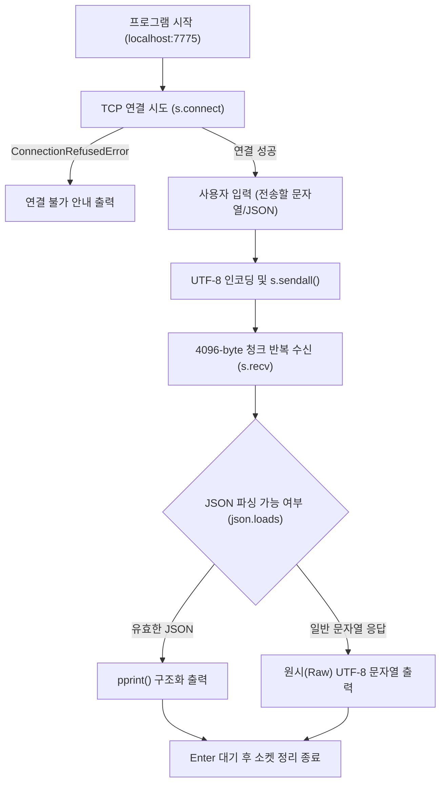

# SocketClient

> **포트 `7775` TCP 소켓 서버 응답 검증을 위한 무의존성(Zero-Dependency) Python 진단 클라이언트**


`SocketClient`는 C# 기반 TCP-MySQL 소켓 서버([`RunServer_DB_socketAPI`](https://github.com/tejo1990/RunServer_DB_socketAPI) 및 [`RunServer`](https://github.com/tejo1990/RunServer))에 임의의 문자열 명령이나 JSON 페이로드를 전송하고, 수신된 대용량 바이트 청크를 재조립하여 가독성 높게(`pprint`) 출력하는 **초경량 Python TCP 테스트 도구**입니다.

---

## 1. Why (제작 목적 및 배경)

C# 소켓 서버 개발 중 매번 무거운 클라이언트 프로젝트를 빌드하지 않고도 **이종 언어(Cross-Language) 환경에서 TCP 바이트 인코딩(UTF-8), 청크 분할 수신, JSON 직렬화 호환성**을 즉각 검증하기 위해 제작했습니다.

- **외부 패키지 설치 불필요**: Python 표준 라이브러리(`socket`, `json`, `pprint`)만 사용하여 어떤 개발/서버 환경에서도 `python sendString.py` 한 줄로 즉시 실행됩니다.
- **안전한 예외 진단**: JSON 파싱 실패(`JSONDecodeError`) 시 크래시 대신 서버가 보낸 원시(Raw) UTF-8 문자열을 그대로 출력하여 프로토콜 오류 원인을 즉시 파악할 수 있습니다.

### 연관 소켓/서버 생태계 (Related Repositories)

| 레포지토리 | 역할 및 버전 | 기술 스택 | 프로토콜 프레이밍 |
| :--- | :--- | :--- | :--- |
| **[`SocketClient`](https://github.com/tejo1990/SocketClient)** *(현재 레포)* | **무의존성 Python TCP 송수신 진단 클라이언트** | Python 3 (`socket`, `json`) | Raw / JSON (Port `7775`) |
| [`RunServer_DB_socketAPI`](https://github.com/tejo1990/RunServer_DB_socketAPI) | v1 TCP-MySQL 브리지 서버 (`search` / `save` / `data` 응답 후 EOF 종료) | C# / .NET Framework 4.8 | JSON / Raw (Port `7775`) |
| [`RunServer`](https://github.com/tejo1990/RunServer) | v2 비동기 멀티 클라이언트 TCP & MySQL 세션 서버 | C# / .NET 8.0 / MySQL | JSON + `\n` (Port `7775`) |
| [`SClient`](https://github.com/tejo1990/SClient) | v2 `RunServer` 전용 대화형 C# CLI 클라이언트 | C# / .NET 8.0 | JSON + `\n` (Port `7775`) |
| [`servermanager`](https://github.com/tejo1990/servermanager) | 2초 주기 TCP 서버 상태 감시(Watchdog) 데몬 | C# / .NET 8.0 | JSON + `<EOP>` (Port `7775`) |

---

## 2. What (핵심 기능 및 동작 흐름)

- **IPv4 TCP 스트림 연결**: 기본 `localhost:7775`로 `socket.AF_INET` / `socket.SOCK_STREAM` 연결을 수립합니다.
- **대화형 페이로드 입력 및 UTF-8 전송**: 콘솔에서 입력받은 문자열(예: `data`, `{"type":"search","id":"1"}`)을 UTF-8로 인코딩하여 `sendall()`로 전체 바이트 전송을 보장합니다.
- **4096B 청크 루프 수신**: 서버가 스트림을 닫을 때까지(`not chunk`) `s.recv(4096)` 루프로 응답 버퍼를 누적합니다.
- **JSON 자동 파싱 및 원시 데이터 폴백**:
  - 유효한 JSON 응답일 경우 `pprint`로 정렬 출력합니다.
  - 일반 텍스트 상태 메시지(예: `"데이터가 성공적으로 저장되었습니다."`)일 경우 `JSONDecodeError` 핸들러가 원시 문자열을 안전하게 출력합니다.
  - 서버 미기동 시 `ConnectionRefusedError`를 명확히 안내합니다.

---

## 3. How (아키텍처 및 코드 구조)

### 3.1 실행 흐름 다이어그램



### 3.2 파일 구성

```text
SocketClient/
└── sendString.py    # TCP 연결, 문자열/JSON 송신, 4KB 청크 수신 및 JSON/Raw 출력 스크립트
```

---

## 4. Quick Start (로컬 즉시 실행 가이드)

### 4.1 사전 요구사항

- **Python 3.8 이상** (`pip` 추가 설치 불필요)
- 포트 `7775`에서 리스닝 중인 TCP 서버 (예: [`RunServer_DB_socketAPI`](https://github.com/tejo1990/RunServer_DB_socketAPI) 또는 로컬 에코/목업 서버)

### 4.2 실행 방법

```bash
git clone https://github.com/tejo1990/SocketClient.git
cd SocketClient

python sendString.py
```

### 4.3 테스트 입력 예시 (`RunServer_DB_socketAPI` 연동 시)

```text
서버 localhost:7775에 연결되었습니다.
전송할 문자열을 입력하세요: {"type": "search", "id": "1"}
'{"type": "search", "id": "1"}' 문자열을 서버로 전송했습니다.

받은 JSON 데이터:
{'ID': 1, 'PW': 'sample', 'contentID': 'C01'}
```

> **참고**: 서버 없이 단독으로 동작을 바로 확인해보고 싶다면 다른 터미널에서 아래 1줄 Python 목업 서버를 띄운 뒤 `python sendString.py`를 실행하면 즉시 왕복 JSON 응답을 확인할 수 있습니다.
> ```bash
> python -c "import socket,json; s=socket.socket(); s.bind(('localhost',7775)); s.listen(1); c,_=s.accept(); req=c.recv(1024).decode(); c.sendall(json.dumps({'ok':True,'echo':req}).encode()); c.close(); s.close()"
> ```
